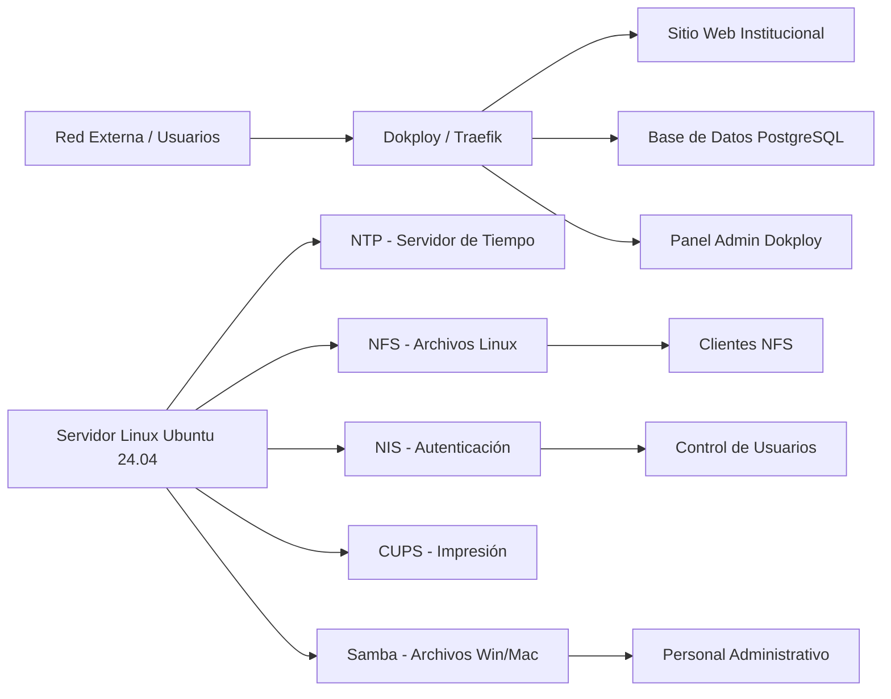

# 1. Análisis de Necesidades y Diseño de Infraestructura

## 1.1 Justificación de Servicios
Para soportar la operación administrativa y los servicios al ciudadano de la **Cámara de Comercio de Armenia y del Quindío**, se requiere una infraestructura tecnológica robusta, segura y centralizada. En primer lugar, se implementó la plataforma PaaS **Dokploy** apoyada en el proxy inverso **Traefik**. Esta arquitectura permite el despliegue ágil del sitio web institucional (Nginx) bajo el protocolo seguro HTTPS, garantizando que el portal de trámites y la consulta de requisitos operen con confidencialidad e integridad. Como motor de base de datos se seleccionó **PostgreSQL**, un sistema relacional de código abierto reconocido por su integridad transaccional, ideal para respaldar el registro mercantil y los datos de los afiliados dentro de una red privada aislada de Internet.

Por otro lado, la trazabilidad y la auditoría son pilares legales en una Cámara de Comercio. Por ello, se implementó un servidor de tiempo (**NTP / NTPsec**) nativo en Linux para garantizar una sincronización horaria precisa en toda la red, asegurando que las marcas de tiempo en transacciones web, certificados y registros de base de datos sean consistentes. Para el manejo de archivos internos, se configuró **NFS** como repositorio centralizado de documentos legales y administrativos optimizado para servidores y estaciones Linux de la entidad.

Finalmente, para el trabajo colaborativo diario de los funcionarios que utilizan estaciones Windows y macOS, se desplegó un servidor **Samba** protegido por grupos de acceso. La gestión de credenciales en los servicios internos se centralizó mediante **NIS** (*Network Information Service*), evitando la administración descentralizada de usuarios. El ecosistema se completa con **CUPS**, encargado de centralizar las colas de impresión para la emisión física de certificados mercantiles, reforzado con medidas adicionales de seguridad perimetral (**UFW**), respaldos automáticos locales y monitoreo con alertas.

## 1.2 Requisitos Técnicos

| Servicio | Dominio / IP | Puerto | Protocolo | Tipo de Servicio |
| :--- | :--- | :--- | :--- | :--- |
| **Web Server (Nginx)** | `camara.villadastudios.com` | 80 / 443 | HTTP / HTTPS | Dokploy (Contenedor) |
| **PostgreSQL** | Red Interna (Docker) | 5432 | TCP | Dokploy (Contenedor) |
| **Panel Admin** | `35.225.203.150` | 3000 | TCP | Dokploy UI |
| **SSH (Administración)** | `35.225.203.150` | 22 | TCP | Linux Nativo |
| **NTP (NTPsec)** | Red Local / IP Servidor | 123 | UDP | Linux Nativo |
| **NFS** | Red Local / IP Servidor | 2049 | TCP / UDP | Linux Nativo |
| **NIS** | Red Local / IP Servidor | 111 / YPSERV | TCP / UDP | Linux Nativo |
| **CUPS** | Red Local / IP Servidor | 631 | TCP | Linux Nativo |
| **Samba** | Red Local / IP Servidor | 139 / 445 | TCP | Linux Nativo |

## 1.3 Diagrama de Arquitectura

